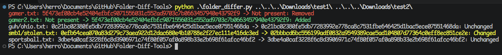
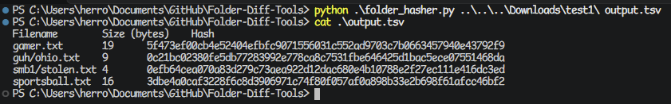

# Folder Diff Tools
A small set of Python 3 utility scripts for recursively comparing folders.

## [Folder Differ](folder_differ.py)
Compare two folders, outputting the hashes of every file recursively. Reports to STDOUT whether the file was added, removed, changed, or unchanged from folder 1 to folder 2.

Usage:
```sh
python folder_differ.py folder1 folder2
```



## [Folder Hasher](folder_hasher.py)
Recursively compute the hashes of every file in a folder, outputting the file path, size, and hash to an output TSV.

Usage:
```sh
python folder_hasher.py folder output.tsv
```


